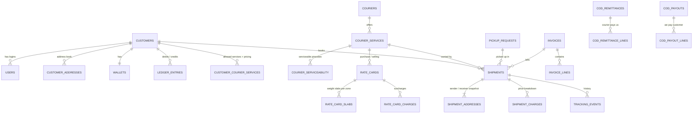

# Database Design: Multi-Courier Booking, Tracking & ERP Platform

**Database:** PostgreSQL 16+ · **Schema file:** [schema.sql](schema.sql) · **Tables:** 60 (55 regular + 5 partitioned)

This document covers deliverable #2 ("Database design") from the requirement document. It explains how the data is organised, why it is organised that way, and how the database will keep up as volume grows.

---

## 1. Design principles

| Principle | What it means in this schema |
|---|---|
| **One normalised shipment model for every courier** | Each courier's own status codes are mapped onto 18 platform statuses (`courier_status_mappings`). Dashboards, reports and notifications work the same way for every courier. |
| **Couriers are data, not code** | Adding a courier means inserting rows (`couriers`, `courier_services`, credentials, serviceability, status mappings) and choosing an adapter. No schema change is needed. |
| **History is never rewritten** | Shipment addresses and prices are **snapshots** taken at booking. `ledger_entries` and `tracking_events` are append-only. Corrections are new rows. |
| **The database enforces the integrity rules** | Duplicate AWBs, duplicate bookings, double wallet deductions, duplicate tracking events and paying out a COD twice are blocked by unique constraints. The database rejects them even if the application has a bug. |
| **Money is exact** | Every amount is `NUMERIC(14,2)`. Weight is stored in integer grams. Floats are never used. |
| **Internal cost is kept separate** | Purchase cost (`cost_amount`) sits beside the selling price, and the API layer exposes it only to staff roles. |
| **Built to scale** | The five highest-volume log tables are partitioned by month. Work-queue indexes are partial, so they stay small. Dashboard counts come from pre-aggregated tables. |

---

## 2. Modules and tables

| Module | Tables | Client requirement |
|---|---|---|
| **Master data** | `countries`, `states`, `pincodes`, `hs_codes` | Pincodes, GST state codes, HS codes |
| **Identity & access** | `roles`, `permissions`, `role_permissions`, `users`, `user_sessions` | §9 secure login, §13 user permissions, §14 role-based access |
| **Customers** | `customers`, `customer_addresses`, `customer_documents`, `files` | §9 customer panel, §13 create/edit/block customers |
| **Couriers & integration** | `couriers`, `courier_services`, `courier_credentials`, `courier_pickup_locations`, `courier_serviceability`, `courier_status_mappings`, `courier_awb_stock` | §1–2 integrations, §13 add a courier and configure credentials without a developer, §15 manual fallback |
| **Rate engine** | `zones`, `zone_rules`, `zone_countries`, `rate_cards`, `rate_card_slabs`, `rate_card_charges`, `customer_courier_services`, `tax_rates` | §8 rate comparison, customer-wise rates, slabs, surcharges, GST, margin |
| **Booking & shipments** | `shipments`, `shipment_addresses`, `shipment_packages`, `shipment_items`, `shipment_documents`, `shipment_charges`, `bulk_uploads` | §3 booking, §4 AWB and label, §9 bulk Excel booking, §12 international |
| **Pickup** | `pickup_requests` | §5 automatic pickup |
| **Tracking** | `tracking_events` *(partitioned)*, `webhook_events` *(partitioned)* | §6 live tracking, webhooks and polling |
| **Billing & accounts** | `wallets`, `ledger_entries`, `payments`, `payment_allocations`, `invoices`, `invoice_lines`, `number_sequences`, `courier_bills`, `courier_bill_lines` | §11 billing, wallet, GST invoices, outstanding, purchase bills, profit and loss |
| **COD** | `cod_remittances`, `cod_remittance_lines`, `cod_payouts`, `cod_payout_lines` | §9 COD settlement status, §11 COD reconciliation |
| **Notifications** | `notification_templates`, `notification_preferences`, `notification_logs` *(partitioned)* | §10 SMS, WhatsApp and email |
| **Support** | `support_tickets`, `ticket_messages` | §9 support tickets |
| **System & audit** | `api_request_logs` *(partitioned)*, `audit_logs` *(partitioned)*, `system_settings`, `shipment_daily_stats` | §7 dashboard, §13 API and webhook logs, §14 error logs and monitoring |

---

## 3. Core entity relationships



---

## 4. Key decisions explained

### 4.1 Shipment type is split into three fields
The requirement lists "Prepaid, COD, To Pay, Reverse Pickup, International" as one list. These are really independent attributes: a reverse pickup can be prepaid, and an international shipment can be prepaid. The schema stores them separately:

- `payment_mode`: `prepaid` | `cod` | `to_pay`
- `direction`: `forward` | `reverse`
- `is_international`: boolean

The booking UI can still show the client's five options and map each one onto these fields.

### 4.2 Normalised shipment status
Every courier sends different status codes, for example Delhivery `"In Transit"` and Blue Dart `"015"`. Each code is translated through `courier_status_mappings` into one of these 18 statuses:

`draft → booking_confirmed → manifested → pickup_scheduled → picked_up → in_transit → arrived_at_hub → (customs_clearance) → out_for_delivery → delivered`

Off the normal path: `booking_failed`, `delivery_failed`, `exception`, `rto_initiated`, `rto_in_transit`, `returned_to_sender`, `cancelled`, `lost`.

An admin can add a mapping from the UI when a courier introduces a new code. Codes that have no mapping are logged and flagged for review.

### 4.3 How a price is calculated
1. **Zone:** `zone_rules` are evaluated in priority order (same city → same state → metro-to-metro → special region → rest of India). International zones use `zone_countries`.
2. **Chargeable weight:** `max(actual, L×B×H ÷ volumetric_divisor)`, where the divisor is set per service.
3. **Freight:** the matching `rate_card_slabs` row gives the base rate plus a rate for each additional weight unit.
4. **Surcharges:** `rate_card_charges` adds fuel %, COD (percentage or a minimum, whichever is higher), ODA, handling, insurance and so on.
5. **Selling price for this customer** is chosen in this order:
   1. the customer-specific selling card (`customer_courier_services.selling_rate_card_id`), otherwise
   2. purchase cost plus the customer's markup (`markup_percent` / `markup_flat`), otherwise
   3. the default selling card.
6. **GST:** from `tax_rates` (SAC 996812). The rate engine works out CGST+SGST or IGST from the place of supply.

Both the **cost** and **sell** sides are frozen into `shipment_charges` at booking. A later rate change never alters a past shipment, and profit is exact per shipment.

### 4.4 Wallet and ledger
- `ledger_entries` is the source of truth and is append-only. `wallets.balance` is a cached copy for fast reads.
- A booking debit happens in **one transaction**:
  ```sql
  BEGIN;
  SELECT balance FROM wallets WHERE customer_id = $1 FOR UPDATE;   -- serialises concurrent bookings
  -- check balance >= sell_total (prepaid) or credit limit (credit customers)
  INSERT INTO ledger_entries (...) VALUES (... 'debit', 'shipment', shipment_id ...);
  UPDATE wallets SET balance = balance - $amount WHERE customer_id = $1;
  COMMIT;
  ```
- The unique index `ux_ledger_once` means a shipment can be **charged once and refunded once**, even if a job is retried.

### 4.5 Duplicate protection (§14)
| Risk | Protection |
|---|---|
| Customer double-clicks "Book" | `UNIQUE (customer_id, idempotency_key)` on `shipments` |
| Courier returns an AWB that's already used | `UNIQUE (courier_id, awb_number)` |
| Webhook and poll deliver the same tracking event | `UNIQUE (shipment_id, dedupe_hash, event_time)` on `tracking_events` |
| A retried job deducts the wallet twice | `ux_ledger_once` |
| A COD is remitted or paid out twice | `UNIQUE (shipment_id)` on both COD line tables |
| A payment gateway callback arrives twice | `UNIQUE (gateway, gateway_payment_id)` |
| Two workers take the same manual AWB | `SELECT … FOR UPDATE SKIP LOCKED` on `courier_awb_stock` |

### 4.6 Couriers without an API (manual fallback, §15)
`couriers.integration_mode` (`api` / `manual` / `hybrid`) and `couriers.capabilities` record what each integration actually supports. The UI reads these fields to show which steps are automatic and which are manual. For manual couriers:
- serviceability comes from an Excel upload into `courier_serviceability` (`source = 'upload'`)
- AWBs come from a pre-allotted series in `courier_awb_stock`
- pickups are created with `pickup_requests.is_manual = true`
- tracking is updated by admins or by Excel upload (`tracking_events.source = 'manual'`)

### 4.7 Security
- **Courier API secrets** are encrypted in the application with AES-256-GCM before they are stored (`courier_credentials.secret_ciphertext`). The key lives in AWS KMS, never in the database. `key_id` makes key rotation possible.
- **Passwords:** argon2id hashes. Only the SHA-256 hash of each refresh token is stored.
- **Logs:** credentials, and PII where needed, are masked before rows are written to `api_request_logs` and `webhook_events`.
- **Purchase cost and margin** columns are never selected by customer-facing queries; separate customer and staff DTOs enforce this.
- **Audit trail:** every change to rates, credentials, customers, permissions and manual status corrections is written to `audit_logs`.

---

## 5. Scalability plan

### 5.1 Expected volume (planning assumption: 10,000 shipments/day)
| Table | Rows / year | Strategy |
|---|---|---|
| `shipments` | ~3.6 M | Indexed regular table. Comfortable to 50 M+ rows; partition by `created_at` if that is exceeded. |
| `tracking_events` | ~36–50 M (10–15 events per shipment) | **Monthly partitions** |
| `api_request_logs` | ~50 M+ | **Monthly partitions**, keep 6–12 months |
| `webhook_events` | ~30 M | **Monthly partitions**, keep 3–6 months |
| `notification_logs` | ~20 M | **Monthly partitions** |
| `audit_logs` | small but kept long | **Monthly partitions**, keep 7+ years |

### 5.2 Partitioning
- Five tables are `PARTITION BY RANGE` on their timestamp. The schema ships with a `DEFAULT` partition so nothing fails on day 1.
- **Before go-live:** install **pg_partman** to create monthly partitions in advance and detach or drop old ones automatically.
- Dropping an old month's partition is instant, whereas `DELETE` on millions of rows is slow and bloats the table.

### 5.3 Indexing strategy
- **Partial "work-queue" indexes** cover only live rows, so they stay small however many shipments are delivered:
  - `ix_shipments_poll_due`: shipments the tracking poller still needs to check
  - `ix_shipments_cod_open`: COD shipments not yet settled
  - `ix_shipments_unbilled`: shipments not yet invoiced
  - `ix_webhook_events_pending`, `ix_tickets_open`, `ix_invoices_outstanding`
- **Admin search (§7):** btree indexes on AWB and mobile; trigram (`pg_trgm`) GIN indexes on customer name and consignee name for partial matches. If search load grows, move it to OpenSearch.
- **Composite indexes start with the filter column and end with the sort column**, e.g. `(customer_id, created_at DESC)` for "my bookings".

### 5.4 Keeping dashboards fast
- `shipment_daily_stats` is updated by the worker on every status change. The control tower dashboard and courier-wise or customer-wise reports read this table, never `shipments` directly.
- Live counts ("pickup pending right now") are cached in Redis for 30–60 seconds.

### 5.5 Infrastructure path
| Stage | Setup |
|---|---|
| Launch | One PostgreSQL instance (AWS RDS) with automated backups and point-in-time recovery, plus **PgBouncer** for connection pooling |
| Growth | Add a **read replica**; route reports, exports and dashboards to it |
| Scale | Separate heavy logs into their own database, or archive old partitions to S3 (Parquet) |
| Large scale | Partition `shipments`, or shard by customer (e.g. Citus). Unlikely to be needed below ~100k shipments/day. |

### 5.6 Caching (Redis, not the database)
- Serviceability by `(service, pincode)`, kept for 24h and cleared when the admin uploads new data
- Active rate cards per customer, cleared when a rate card is saved
- Rate quotes shown to the customer, kept for about 15 minutes so the booked price matches the quoted price
- Public tracking page responses, kept for about 60 seconds

---

## 6. Data retention (to confirm with the client)
| Data | Proposed retention |
|---|---|
| Shipments, invoices, ledger, payments | 8 years (GST and accounting record-keeping) |
| Tracking events | 2 years online, then archived |
| API request logs | 6 months |
| Webhook events | 3 months |
| Notification logs | 1 year |
| Audit logs | 8 years |

---

## 7. Operational notes for developers
- Manage schema changes with migrations (Prisma Migrate / TypeORM). Treat `schema.sql` as the reference baseline.
- New enum values: `ALTER TYPE shipment_status ADD VALUE 'x';` works without downtime. Values can't be removed, so add them carefully.
- Update `shipments` with optimistic locking: `UPDATE … SET …, version = version + 1 WHERE id = $1 AND version = $2`.
- Generate invoice numbers inside the invoice transaction: `UPDATE number_sequences SET next_value = next_value + 1 WHERE series='invoice' AND financial_year=$1 RETURNING next_value - 1`. This keeps the series gapless, as GST requires.
- Store every timestamp in UTC (`TIMESTAMPTZ`) and convert to IST only in the UI.

---

## 8. Open questions for the client
1. Expected daily shipment volume at launch and after one year? This decides the instance size and when the read replica is needed.
2. Is the client's turnover above the GST **e-invoicing** threshold? If so, IRN generation is required on invoices.
3. Are COD payouts to customers net of freight (`cod_payouts.deductions`) or paid in full?
4. Billing cycle for credit customers: weekly, fortnightly or monthly?
5. Should customers be able to create their own sub-users (`customer_admin` / `customer_operator` roles)?
6. Are the retention periods in §6 acceptable?
