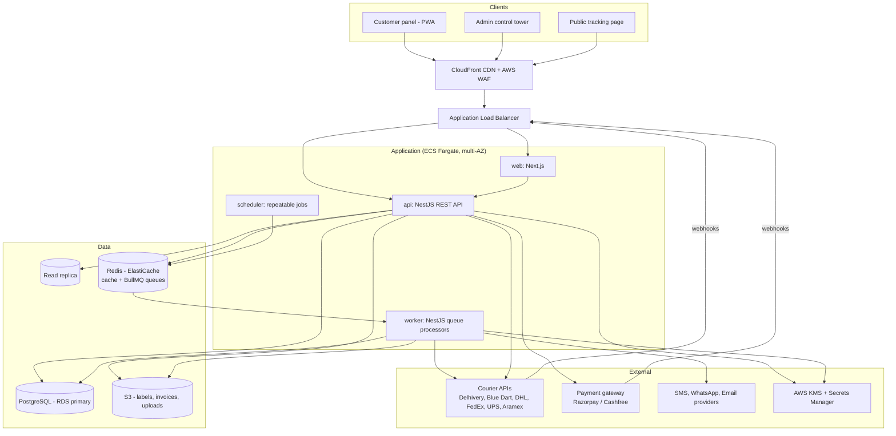
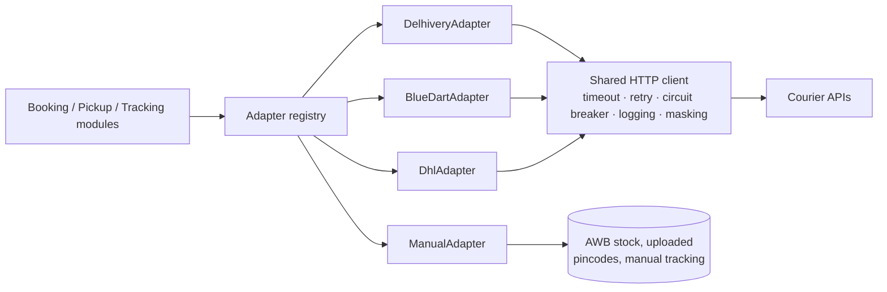
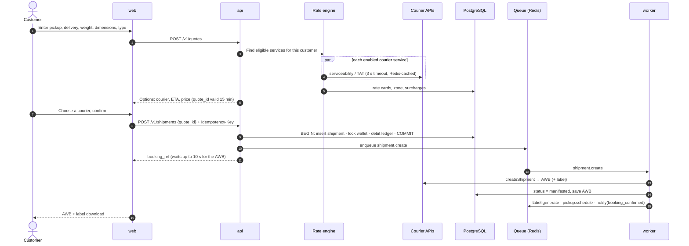
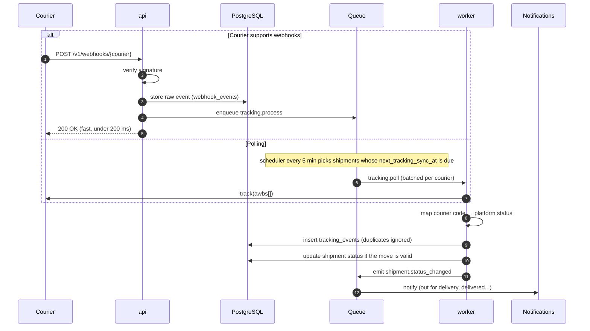
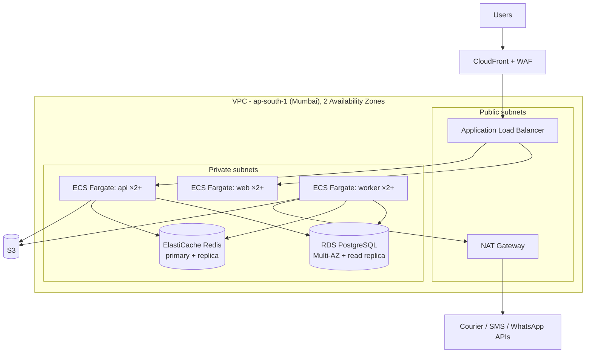

# System Architecture: Multi-Courier Booking, Tracking & ERP Platform

**Deliverable #1** · Companion documents: [Database design](../database/DATABASE_DESIGN.md), [schema.sql](../database/schema.sql)

---

## 1. Goals the architecture is built around

| Goal | How the architecture meets it |
|---|---|
| **Many couriers, one platform** | A courier adapter layer: each courier is a plug-in behind one common interface. A new courier is a new adapter plus configuration rows. |
| **Maximum automation** | Every step after booking (AWB, label, pickup, tracking, notifications, billing) runs as a background job with automatic retries. |
| **Honest fallbacks** | Each courier declares what its integration supports. Anything unsupported falls back to a manual workflow, and the screens say so. |
| **Scalable** | Stateless API servers and separately scaled background workers, with PostgreSQL, Redis and S3 as managed services. |
| **Reliable** | Idempotent operations, retries with backoff, circuit breakers on courier APIs, multi-AZ database, point-in-time recovery. |
| **Secure** | Role-based access, encrypted courier credentials, customer data isolation, an audit trail, and alignment with India's DPDP Act. |

**Architecture style:** a **modular monolith** with **separate worker processes**. One codebase is divided into strict modules (booking, rates, tracking, billing...). It deploys as three runtime services: **web**, **api** and **worker**. Each scales on its own. If load ever requires it, a module can be extracted into its own service without rewriting it.

---

## 2. High-level architecture



### Runtime services

| Service | Responsibility | Scales on |
|---|---|---|
| **web** (Next.js) | Customer panel, admin panel and public tracking page. One app with three route groups: `/app`, `/admin`, `/track`. Installable as a PWA. | Request count |
| **api** (NestJS) | REST API, authentication, validation, rate quotes, booking transactions, webhook intake | CPU and request count |
| **worker** (NestJS, same codebase) | Everything slow or external: AWB, labels, pickups, tracking, notifications, bulk import, invoicing, exports | **Queue depth** |
| **scheduler** (one instance) | Repeatable jobs: tracking polls, delay alerts, invoice cycles, nightly pincode sync | Fixed: 1 |

The API **never does slow work inside a user's request** unless the answer is needed right then (rate quotes). Everything else goes through a queue.

---

## 3. Codebase structure

A single repository (pnpm workspaces + Turborepo):

```
courier-erp/
├── apps/
│   ├── web/                  Next.js (customer, admin, public tracking)
│   └── server/               NestJS: one codebase, two entrypoints
│       ├── src/main.api.ts       → starts the REST API
│       ├── src/main.worker.ts    → starts the queue processors
│       └── src/modules/
│           ├── auth/             login, JWT, sessions, RBAC (CASL)
│           ├── customers/        customers, addresses, KYC
│           ├── couriers/         courier config, credentials, serviceability
│           ├── rates/            zones, rate cards, quote engine
│           ├── booking/          shipments, idempotency, bulk upload
│           ├── pickup/
│           ├── tracking/         webhooks, polling, status mapping
│           ├── billing/          wallet, ledger, invoices, payments, COD
│           ├── notifications/
│           ├── support/
│           ├── reports/          dashboard stats, exports
│           └── admin/            settings, audit, API logs
├── packages/
│   ├── courier-adapters/     one folder per courier + the manual adapter
│   ├── shared/               Zod schemas, types, status enums (used by web and server)
│   └── pdf/                  label, invoice and commercial-invoice templates
├── database/                 schema.sql, migrations
└── infra/                    Terraform (AWS), Dockerfiles, CI/CD
```

**Module rules:**
- A module touches only its own tables. It uses another module only through that module's service interface, never through its tables.
- Modules communicate through **domain events**, for example `shipment.manifested` and `shipment.delivered`. Billing, notifications and stats subscribe to them, so booking doesn't need to know they exist.
- Validation schemas live in `packages/shared` and are used by **both** the frontend and the API, so the two never disagree.

---

## 4. Courier integration layer

The most important part of the system. Every courier, with or without an API, implements one interface:

```ts
export interface CourierAdapter {
  readonly code: string;                       // 'delhivery', 'bluedart', 'manual'
  readonly capabilities: CourierCapabilities;  // what this integration really supports

  checkServiceability(req: ServiceabilityRequest): Promise<ServiceabilityResult>;
  createShipment(req: CreateShipmentRequest): Promise<CreateShipmentResult>; // → AWB (+ label if the courier gives one)
  track(awbs: string[]): Promise<TrackingUpdate[]>;                          // batch where the API allows

  getTransitTime?(req: TatRequest): Promise<TatResult>;
  getLabel?(awb: string): Promise<LabelResult>;
  schedulePickup?(req: PickupRequest): Promise<PickupResult>;
  cancel?(awb: string): Promise<CancelResult>;
  parseWebhook?(headers: Record<string, string>, body: unknown): TrackingUpdate[]; // verifies the signature first
}

export interface CourierCapabilities {
  serviceabilityApi: boolean;
  awbApi: boolean;
  labelApi: boolean;
  pickupApi: boolean;
  trackingWebhook: boolean;
  trackingPoll: boolean;
  cancelApi: boolean;
  batchTrackingSize: number;   // e.g. 50 AWBs per call
}
```



| Concern | How it's handled |
|---|---|
| **Selecting an adapter** | `couriers.adapter_key` → registry → adapter instance. Credentials are loaded from the database, decrypted through KMS and cached in memory for 5 minutes. |
| **Missing capability** | The calling module checks `capabilities` first. Example: `pickupApi = false` creates a manual pickup task for operations staff instead of calling the API. |
| **Timeouts** | Serviceability and quote calls: **3 s**. AWB, pickup and tracking calls: **15 s**. |
| **Retries** | Only on network errors, HTTP 5xx and 429, with exponential backoff. Never on 4xx validation errors. |
| **Circuit breaker** (opossum) | After repeated failures a courier is marked *temporarily unavailable* for 60 s. Quotes skip it and booking shows a clear message. The rest of the platform is unaffected. |
| **Logging** | Every request and response goes to `api_request_logs`, with secrets and personal data masked. |
| **Status mapping** | Each adapter returns the courier's raw codes. The tracking module maps them to the platform's 18 statuses through `courier_status_mappings`. |
| **Testing** | Each adapter has contract tests against the courier's sandbox, plus recorded responses for CI. |

**Adding a new courier:** write one adapter class (typically 2–5 days of work, depending on how good the courier's API is), register it, then configure everything else (services, credentials, pincodes, status mappings) from the admin panel.

---

## 5. Key flows

### 5.1 Quote and booking



- The API holds the request open for up to **10 seconds** while the AWB job runs. Usually the customer gets the AWB in the same screen. If the courier is slow, they see "Booking confirmed, AWB is being generated" and the page updates when it's ready.
- If AWB generation fails after every retry, the shipment moves to `booking_failed`, the wallet is **refunded automatically**, and operations staff get an alert.
- The quote's price is locked for 15 minutes, so the price charged is the price shown.

### 5.2 Tracking: webhooks and polling



- **Adaptive polling:** shipments out for delivery are polled every 30 minutes, in transit every 2 hours, and pickup pending every 1 hour. Delivered shipments are never polled again. This keeps courier API usage low.
- **Status state machine:** a late-arriving old event (for example "in transit" arriving after "delivered") is saved in the history but **never moves the status backwards**.
- Webhooks are stored before processing, so any event can be replayed if processing fails.

### 5.3 Pickup
After the AWB is generated, `pickup.schedule` groups the day's shipments from the same pickup address and courier into **one pickup request**. If the courier has no pickup API, or the API call fails after its retries, a manual pickup task appears on the operations dashboard with an alert.

---

## 6. Background jobs (BullMQ queues)

| Queue | Triggered by | Retry policy | On final failure |
|---|---|---|---|
| `shipment.create` | Booking confirmed | 5 tries, backoff 10 s → 5 min | `booking_failed`, wallet refund, alert |
| `label.generate` | AWB received | 3 tries | Label regenerated on download |
| `pickup.schedule` | AWB received / customer request | 5 tries | Manual pickup task + alert |
| `tracking.process` | Webhook received | 5 tries | Event marked failed, visible in the admin webhook log |
| `tracking.poll` | Scheduler (every 5 min) | 3 tries | Retried on the next cycle |
| `notify.send` | Status-change events | 3 tries, limited per provider rate | Logged as failed |
| `bulk.import` | Excel upload | Per row | Error report Excel for the customer |
| `cod.reconcile` | Remittance file upload | 3 tries | Unmatched lines listed for review |
| `billing.invoice` | Scheduler (billing cycle) | 3 tries | Alert to accounts |
| `report.export` | Large export requested | 3 tries | Customer notified |
| `serviceability.sync` | Nightly | 3 tries | Previous data kept |
| `alerts.scan` | Hourly | — | Delayed-shipment and pending-pickup alerts |
| `stats.aggregate` | Status-change events | 5 tries | Nightly full rebuild corrects drift |

Failed jobs stay visible in a queue dashboard (Bull Board) in the admin panel, where staff can retry them.

---

## 7. API design

| Topic | Convention |
|---|---|
| Style | REST + JSON, versioned under `/api/v1`. OpenAPI (Swagger) docs generated from code. |
| Auth | Short-lived JWT access token (15 min) + rotating refresh token in an httpOnly cookie. Optional API keys for customers who want to book from their own systems. |
| Authorization | CASL permissions checked on every route. **The customer ID always comes from the token, never from the request**, so one customer can't read another's data. |
| Customer vs staff views | Separate response DTOs. Purchase cost and margin fields don't exist in customer responses. |
| Idempotency | `Idempotency-Key` header required on booking, payment and wallet endpoints. |
| Pagination | Cursor-based (`?cursor=…&limit=50`), so lists stay fast at millions of rows. |
| Errors | One format: `{ "error": { "code": "COURIER_UNAVAILABLE", "message": "...", "details": [...] } }` |
| Rate limiting | Per user and per IP (Redis-backed). Public tracking: 30 lookups/min per IP. |
| Long operations | Exports and bulk uploads return `202 Accepted` with a job ID to check progress. |

---

## 8. Security architecture

| Layer | Controls |
|---|---|
| **Network** | AWS WAF (OWASP rules, bot and rate rules) on CloudFront. App, database and Redis in **private subnets**. Only the load balancer is public. |
| **Transport** | TLS everywhere, HSTS, and TLS on database and Redis connections. |
| **Identity** | argon2id passwords, account lockout, optional TOTP 2FA (required for Super Admin), session revocation. |
| **Authorization** | RBAC with permissions editable from the admin panel; every query scoped by customer. |
| **Secrets** | Courier credentials encrypted with AES-256-GCM (envelope encryption with AWS KMS). App secrets in AWS Secrets Manager, never in code or environment files. |
| **Files** | Private S3 bucket. Downloads only through short-lived signed URLs after a permission check. |
| **Webhooks** | Signature verification, plus an IP allowlist where the courier publishes one. Payment webhooks verified with the gateway signature. |
| **Data protection** | Personal data masked in logs. Data retention schedule. Region: AWS **Mumbai (ap-south-1)** to keep data in India (DPDP Act 2023). |
| **Audit** | Every admin change, login, export and manual status correction recorded in `audit_logs`. |
| **Application** | Input validation (Zod) on every endpoint, ORM-parameterised queries, Helmet security headers, CSRF protection for cookie auth, dependency scanning in CI. |

---

## 9. Deployment architecture (AWS)



| Item | Choice |
|---|---|
| Containers | Docker images, run on **ECS Fargate** (no servers to manage). Auto-scaling: api on CPU and request count, worker on queue depth. |
| Database | **RDS PostgreSQL 16**, Multi-AZ, automated backups, 7–35 day point-in-time recovery, PgBouncer (RDS Proxy) for connection pooling. |
| Cache/queues | **ElastiCache Redis** with a replica and automatic failover. |
| Outbound IP | All courier calls leave through a **NAT gateway with a fixed Elastic IP**. Several couriers require a whitelisted IP. |
| Environments | `dev` → `staging` (courier sandbox credentials) → `production`. Infrastructure is identical, defined in Terraform. |
| CI/CD | GitHub Actions: lint → tests → build images → database migrations → deploy to staging → manual approval → production (rolling deploy, automatic rollback on failed health checks). |
| Cost-conscious start | For the demo and early phase, the same design can run on a single EC2 instance with Docker Compose plus RDS. Migrating to ECS later doesn't require code changes. |

---

## 10. Scalability and reliability

| Concern | Approach |
|---|---|
| More users | Add api/web containers. They're stateless; sessions and cache live in Redis. |
| More shipments | Add worker containers. Queue throughput scales close to linearly. |
| Heavy reports | Served from the read replica and pre-aggregated stats tables, never from the main tables. |
| Database growth | Monthly partitions for log and tracking tables; partial indexes for work queues (see database design §5). |
| A courier goes down | Circuit breaker isolates it. Other couriers keep working, and its jobs wait and retry. |
| A webhook burst | Webhooks are stored and queued in under 200 ms, then processed at a controlled rate. |
| Infrastructure failure | Multi-AZ database and Redis, at least two containers per service across two availability zones. |
| Disaster recovery | **RPO ≤ 5 minutes** (point-in-time recovery), **RTO ≤ 1 hour**. Restores tested quarterly. Daily snapshot copied to a second region. |

### Proposed performance targets

| Metric | Target |
|---|---|
| Rate quote (all couriers) | p95 under 3 s |
| Booking confirmation with AWB | p95 under 10 s |
| Public tracking page | p95 under 1 s |
| Tracking freshness (webhook couriers) | Under 2 minutes |
| Platform availability | 99.9% monthly |

---

## 11. Observability

| Signal | Tool | Used for |
|---|---|---|
| Errors | **Sentry** (web + api + worker) | Stack traces, release tracking |
| Logs | Structured JSON (Pino) → CloudWatch Logs | Searchable by `correlation_id` across api → queue → worker → courier call |
| Metrics | CloudWatch / Prometheus + Grafana | Request rate, latency, queue depth, job failures, courier API success rate per courier |
| Traces | OpenTelemetry | A booking followed end to end |
| Business health | Admin control tower | Pending pickups, delayed shipments, failed AWBs, webhook failures |

**Alerts (to Slack/email/SMS):** courier API error rate above 10% for 5 minutes · queue backlog over threshold · AWB failures · webhook processing failures · database CPU or storage high · failed scheduled jobs · payment webhook failures.

---

## 12. How the build phases map to the architecture

| Phase | Delivers | Architecture pieces first used |
|---|---|---|
| **0 — Working demo** | Customer login, booking, Delhivery AWB + label, tracking page | web, api, worker, PostgreSQL, Redis, S3, courier adapter layer, Delhivery adapter |
| **1** | Rate engine, admin panel, pickups, notifications | Rates module, scheduler, notification providers |
| **2** | Blue Dart, regional couriers (manual adapter) | More adapters, AWB stock, Excel serviceability upload |
| **3** | Wallet, invoices, COD, reports | Billing module, payment gateway, read replica |
| **4** | International (DHL, FedEx, UPS, Aramex) | International adapters, customs documents, commercial invoice |

---

## 13. Key decisions and alternatives considered

| Decision | Chosen | Alternative | Why |
|---|---|---|---|
| Overall style | Modular monolith + workers | Microservices | Far less operational overhead for a small team, with the same scaling where it matters (workers). Modules can be extracted later. |
| Backend | NestJS (TypeScript) | Laravel (PHP) | One language across web, API and shared validation; strong module structure. Laravel + Horizon is a valid equivalent if the client requires PHP. |
| Database | PostgreSQL | MySQL | Stronger transactions, JSONB for courier payloads, partial indexes, native partitioning, trigram search. |
| Queues | BullMQ on Redis | AWS SQS | Delays, retries, repeatable jobs, rate limits and a dashboard built in, and Redis is already needed for caching. |
| Hosting | AWS Mumbai | Other cloud or VPS | Data stays in India, managed database with point-in-time recovery, every needed service available. |
| Real-time updates | Short polling now, server-sent events later | WebSockets | Polling is enough for booking status; tracking updates are minutes apart. |

---

## 14. Open questions for the client
1. Does the client have an existing AWS account, or another cloud provider preference?
2. Will any customers book through an API from their own websites or ERPs? This decides whether customer API keys are in phase 1.
3. Is there an existing domain and email-sending domain (needed for SES and for WhatsApp business verification)?
4. Expected peak load, such as festival-season volume, to size auto-scaling limits.
5. Who handles operations alerts outside office hours?
